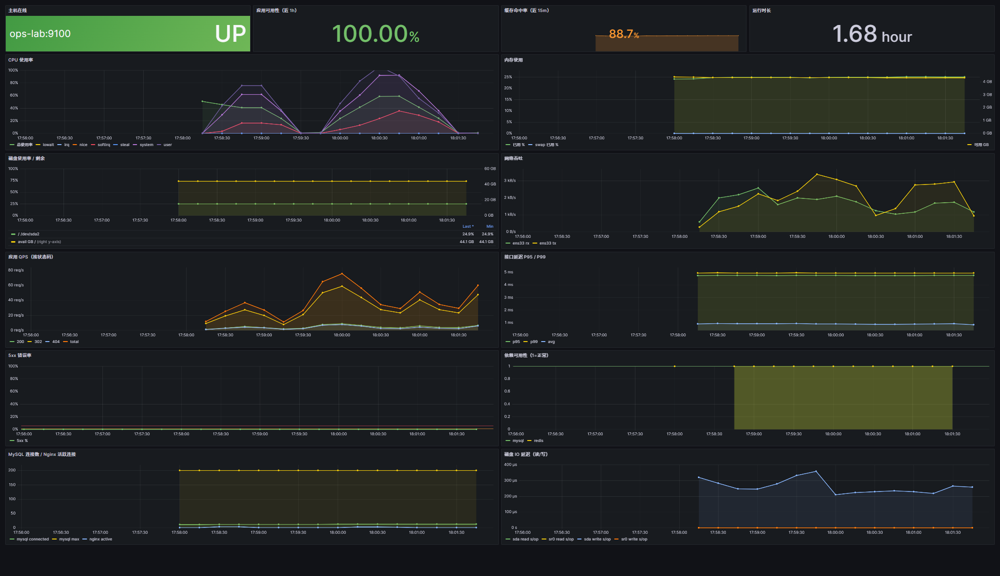

# linux-ops-platform

> 一台 Ubuntu 22.04 服务器，从裸机到「可发布、可监控、可告警、可回滚、可恢复」的完整运维环境。
> 所有配置都在 Git 里，一条命令重建；所有故障都能演练。

CI：GitHub Actions（`ruff` + `pytest` + `promtool`，见 `.github/workflows/ci.yml`）
<!-- 推送到 GitHub 后可以加一行徽章，把 <用户名> 换成自己的：
[](https://github.com/<用户名>/linux-ops-platform/actions/workflows/ci.yml)
-->


## 这是什么

一个**单机但流程完整**的运维实践项目。业务是一个 FastAPI 短链服务（不是重点），
重点是围绕它的一整套运维体系：

| 层次 | 组件 | 我在里面做了什么 |
|------|------|-----------------|
| 系统 | Ubuntu 22.04、systemd、ufw、fail2ban、chrony | 换源、内核参数、文件句柄、swap、SSH 加固、最小权限 sudoers |
| 接入 | Nginx 1.18 | HTTPS、HTTP→HTTPS、限流、JSON 访问日志、内网限制 `/metrics` |
| 应用 | FastAPI + gunicorn | 健康探针、Prometheus 指标、Redis 缓存**可降级**、连接池 |
| 数据 | MySQL 8 + Redis 6.0 | 最小权限账号、慢查询、内存上限 + LRU、备份与恢复演练 |
| 监控 | Prometheus + Alertmanager + Grafana | 7 个抓取目标、28 条告警规则、分组降噪与抑制、自动加载看板 |
| 发布 | releases + current 软链 | 秒级发布/回滚、健康检查失败自动回滚、保留 5 个版本 |
| 日常 | systemd timer | 每日备份（带校验）、5 分钟巡检、每日 08:00 巡检日报、每周恢复演练 |
| 演练 | `ops/chaos/` 6 个脚本 | CPU/磁盘/MySQL/应用/Redis/网络 六类故障可复现 |

> 真机验证：在 VMware + Ubuntu 22.04（4C/6G）上**一共装过 5 遍**——首次安装、在已装好的机器上原样重跑
> （验证幂等：密码哈希不变、43 秒完成）、两台**全新虚拟机**从零复现（7 分钟、8 分 47 秒，两个新机器才有的
> bug 就是这两遍暴露的）、`cleanup.sh` 拆掉再装回，最后还从 **`git clone` 出来的目录**直接装了一遍（285 秒）。
> 装完巡检 20/20、7/7 抓取目标 up、6 类故障全部演练过；发布坏版本能 **34 秒自动回滚**，手动回滚 2 秒。
> CI 的三个 job 也在 Ubuntu 22.04 上预跑过（**11/11 通过**）。完整数据和踩坑记录见
> [docs/05-实机验证报告](docs/05-实机验证报告.md)。

## 架构

```
                         ┌──────────────────────────── 用户 ────────────────────────────┐
                         │                                                              │
                    http :80 ──301──▶ https :443                                    :3000 Grafana
                         │                     │                                        │
                         ▼                     ▼                                        │
                 ┌───────────────┐    ┌──────────────────┐                              │
                 │     Nginx     │───▶│ opslink (gunicorn)│◀── /metrics ── Prometheus ◀──┘
                 │ 限流/JSON日志  │    │  127.0.0.1:8000  │                 │  :9090
                 │ stub_status   │    └────────┬─────────┘                 │
                 └───────┬───────┘             │                           │ 规则计算
                         │ 9113                 │ 连接池 8                    ▼
                 nginx-exporter          ┌─────┴──────┐              Alertmanager :9093
                                         ▼            ▼                    │
                                    ┌────────┐   ┌────────┐          webhook │ :5001
                                    │ MySQL  │   │ Redis  │                  ▼
                                    │ :3306  │   │ :6379  │           告警日志/终端
                                    └────┬───┘   └────────┘
                                         │ 9104
                                    mysqld_exporter      node_exporter :9100（主机指标）

  所有 exporter 只监听 127.0.0.1 —— 只有 Prometheus 能拉，外部拿不到，减少攻击面。
```

## 跑起来是什么样



> 一台 4C/6G 的 Ubuntu 22.04 虚拟机，全部指标来自真实采集：主机资源、应用 QPS/延迟/错误率、
> 缓存命中率、MySQL/Nginx 连接数、依赖可用性。截图时的流量是用 curl 压出来的（200/302/404 混合）。

## 只想先看看代码？

不用装 MySQL/Redis，也能把服务起起来——依赖连不上时业务接口返回 503，但进程、`/health/live`、`/metrics` 都是活的（这就是降级设计）：

```bash
python3 -m venv .venv && . .venv/bin/activate
pip install -r app/requirements.txt
cd app && pytest -q                     # 14 个用例，不依赖中间件，1 秒内跑完

# 故意把依赖指向不存在的端口，看它怎么表现
OPSLINK_MYSQL_PORT=3399 OPSLINK_REDIS_PORT=6399 uvicorn main:app --port 8000 &
curl -s -o /dev/null -w '%{http_code}\n' http://127.0.0.1:8000/health/live   # 200：进程活着
curl -s http://127.0.0.1:8000/health/ready                                   # 503 + 具体原因
curl -s http://127.0.0.1:8000/metrics | head -20                             # 200：指标照常暴露
```

`/health/ready` 的返回是这样的，值班的人一眼能看出是依赖问题而不是代码问题：

```json
{"status":"ok","checks":{"mysql":"error: 数据库暂时不可用，请稍后重试","redis":"degraded"}}
```

## 快速开始

```bash
# 1. 准备：VMware + Ubuntu 22.04 Server，NAT，6GB/4核/60GB，能上网
sudo apt update && sudo apt install -y git
git clone git@github.com:<你的用户名>/linux-ops-platform.git /opt/ops-platform/repo
cd /opt/ops-platform/repo

# 2. 一条命令部署（约 10 分钟，全程有日志）
sudo ./deploy/all_in_one.sh

# 3. 验收（三条命令）
sudo /opt/ops-platform/bin/healthcheck.sh          # 应输出「全部通过：xx 项检查」
sudo systemctl start ops-backup.service && journalctl -u ops-backup -n 20   # 备份成功
curl -s http://127.0.0.1:9090/api/v1/targets | grep -o '"health":"[a-z]*"' | sort | uniq -c  # 全 up
```

> **两种下载方式的区别**：`git clone` 下来的仓库保留脚本的可执行权限，可以直接
> `sudo ./deploy/all_in_one.sh`；网页上 Code → Download ZIP 的包**不保留权限位**，
> 解压后要先 `chmod +x deploy/*.sh scripts/*.sh ops/chaos/*.sh`。仓库里不含任何密码或密钥，
> 首次安装时由 `deploy/lib/common.sh` 的 `get_or_create_secret` 随机生成。

打开界面：

| 地址 | 说明 |
|------|------|
| `https://<IP>/` | 业务入口（自签证书，浏览器选择继续访问） |
| `http://<IP>:9090` | Prometheus：`/targets` 看抓取、`/alerts` 看告警 |
| `http://<IP>:9093` | Alertmanager：告警分组/静默 |
| `http://<IP>:3000` | Grafana，账号 `admin`，密码见 `/etc/ops-platform/platform.env` |

密码为什么在文件里：`deploy/lib/common.sh` 的 `get_or_create_secret` 首次运行时随机生成并写入
`/etc/ops-platform/platform.env`（权限 600），**脚本可重复执行且不会改密码**；密钥永不进 Git。

## 目录结构

```
app/                      业务服务（FastAPI + gunicorn + pytest）
deploy/
  lib/common.sh           常量、日志、下载重试、健康检查等公共函数
  bootstrap.sh            01 系统初始化
  install_middleware.sh   02 MySQL + Redis
  install_app.sh          03 业务应用（首次部署）
  install_nginx.sh        04 Nginx + TLS + 限流
  install_monitoring.sh   05 Prometheus/Alertmanager/Grafana/3 个 exporter
  all_in_one.sh           一键按序执行，日志落盘
  cleanup.sh              拆掉平台（默认保留数据，--purge 才删）
monitoring/
  prometheus/prometheus.yml       抓取配置
  prometheus/rules/*.yml          告警规则（host/app/meta）
  alertmanager/alertmanager.yml   路由、分组、抑制
  grafana/                        数据源、看板 provisioning + 看板 JSON
scripts/
  release.sh rollback.sh          发布 / 回滚
  backup_mysql.sh                 备份（mysqldump + 校验 + 指标）
  restore_test.sh                 每周恢复演练（真的恢复到临时库）
  healthcheck.sh                  全链路巡检（5 分钟一次）
  daily_report.sh                 每日巡检日报（08:00 一份，含 24 小时指标）
  install_timers.sh               安装 systemd timer
  webhook_receiver.py             告警接收器（标准库实现）
ops/chaos/                        6 个故障演练脚本 + 演练手册
docs/                             概述、环境准备、部署手册、On-call、演练记录、验证报告、复现卡
```

## 关键设计决策

**1. 发布用 `releases/<时间戳>` + `current` 软链，而不是 scp 覆盖代码**
发布时新建目录、装依赖、切软链、重启、验健康，失败自动切回上一版。
好处：发布过程中进程不会读到半个文件；回滚只是一次 `ln -sfn`；线上跑的是哪个 commit 一眼可见。

**2. 应用由 systemd 托管，而不是 `nohup`**
`Restart=always` + `RestartSec=3` 让进程被杀后 3 秒自愈；`TimeoutStopSec=35` 保证发布时在途请求处理完。
再配 `NoNewPrivileges` / `ProtectSystem=strict` / `PrivateTmp` —— 即使应用被打穿，能改的东西也很少。

**3. Redis 挂了，业务不能挂**
缓存读失败自动回源 MySQL，并通过 `opslink_dependency_up{dependency="redis"}` 暴露降级状态。
这条指标既上告警（`AppCacheDegraded`），也上大盘 —— **降级必须可见**，否则就成了长期隐患。

**4. 指标 label 不能用真实路径**
middleware 用 `request.scope["route"].path`（路由模板）而不是 `request.url.path`。
否则每来一个短码就多一条时间序列，几千个短链就能把 Prometheus 打爆。这条在测试里有断言。

**5. 告警分层 + 抑制 + `for`**
`critical` 10 秒发出、`warning` 合并 2 分钟；`HostDown` 抑制同实例的 warning，`AppDown` 抑制错误率。
条件都要持续一段时间才告警 —— 抖一下就响的监控，最后一定会被人关掉。

**6. 备份要验证，"备份能恢复"才算备份**
备份后立刻 `gzip -t` + 检查 `Dump completed` + 校验大小，结果写进 textfile 指标；
`BackupStale`（>48h）和 `BackupSizeAnomaly` 会告警。每周日自动把最新备份恢复到临时库比对行数。

**7. 最小权限落在每个角落**
应用账号只有 `opslink.*` 的 DML；监控账号只有 `PROCESS, REPLICATION CLIENT`；
数据库只监听 `127.0.0.1`；exporter 全部只监听 `127.0.0.1`；密码文件 600；
`sudoers` 只放行运维需要的少数命令，不是 `ALL=(ALL) ALL`。

**8. 配置即代码、脚本幂等**
所有配置（Nginx、systemd、Prometheus 规则、Grafana 看板）都在仓库里，
脚本用 `apt_install`、`get_or_create_secret`、`download` 做幂等处理，重复执行不会把环境改坏。
监控配置推上线前先过 `promtool check config` 和 `amtool check-config` —— CI 里也这么做。

## 故障演练

见 [ops/chaos/README.md](ops/chaos/README.md)。六类故障都是一条命令触发、到点自动恢复：

```bash
sudo ops/chaos/01_cpu_spike.sh 4 180        # CPU 打满       → HostHighCPU
sudo ops/chaos/02_disk_fill.sh 85           # 磁盘写满       → HostDiskUsageHigh
sudo ops/chaos/03_mysql_down.sh 120         # MySQL 宕机     → MySQLDown
sudo ops/chaos/04_app_down.sh crash         # 进程被杀       → systemd 3s 自愈
sudo ops/chaos/04_app_down.sh stop 90       # 应用下线       → AppDown + Nginx 502
sudo ops/chaos/05_redis_down.sh 300         # 缓存宕机       → AppCacheDegraded（业务仍可用）
sudo ops/chaos/06_network_delay.sh 300 180  # 网络延迟       → AppHighLatencyP95
```

## 文档

| 文档 | 内容 |
|------|------|
| [docs/00-项目概述](docs/00-项目概述与架构.md) | 架构、端口、数据流、设计取舍 |
| [docs/01-环境准备](docs/01-环境准备.md) | VMware / Ubuntu / 网络 / 快照 |
| [docs/02-部署手册](docs/02-部署手册.md) | 分步部署 + 验收清单 + 常见报错 |
| [docs/03-On-call 手册](docs/03-Oncall手册.md) | 告警响应流程、排查命令速查 |
| [docs/04-故障演练](docs/04-故障演练记录.md) | 演练记录模板与真实记录 |
| [docs/05-实机验证报告](docs/05-实机验证报告.md) | 真机验收矩阵、自愈时间线、踩坑与修复 |
| [docs/06-从零复现操作卡](docs/06-从零复现操作卡.md) | 一页纸照着做：每步该看到什么 + 卡点排查表 |

## 已知局限（如实写）

- 单机部署，没有高可用：Prometheus、MySQL 都是单点，挂了就是挂了（下一步可做 MySQL 主从 + Thanos/VictoriaMetrics 集群）
- 没有容器化/K8s：环境本身是"传统运维"形态，K8s 是后续学习方向，不在本项目范围内
- 告警只到 webhook + 日志，没有接入企业微信/钉钉/短信
- 没有做真正的灰度发布和压力测试（只有 `limit_req` 和简单的 curl 压测）

## License

[MIT](LICENSE)
