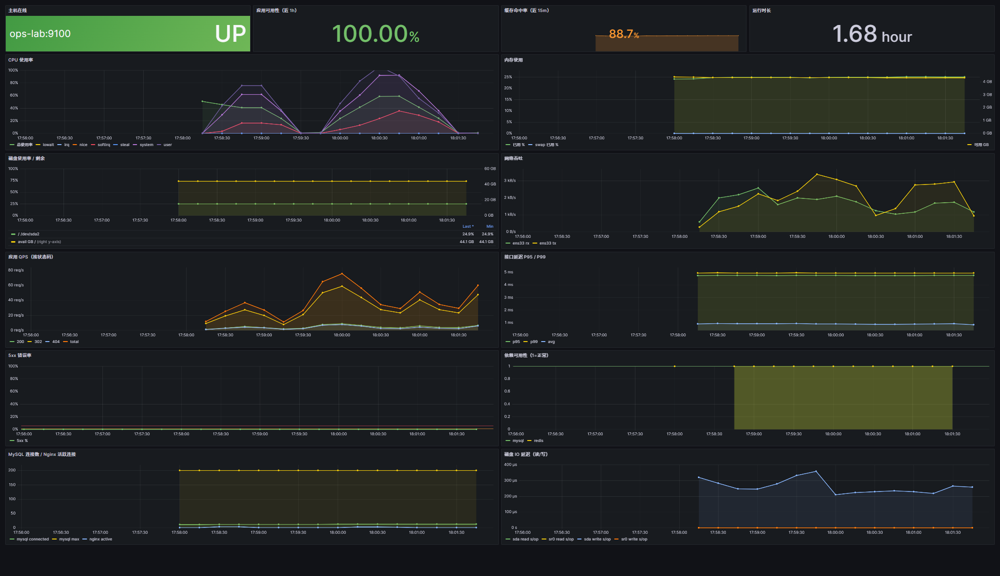

# 09 实机验证报告

> 这份文档不是教程，是**证据**：这个项目真的在一台机器上从裸机装起来、跑起来、被打坏过、也恢复过。
> 面试时被问「你确定跑通过吗」，把这份文档里的数字说出来。

## 1. 验证环境

| 项 | 值 |
| --- | --- |
| 宿主机 | Windows 11 家庭中文版 10.0.22000，i7-12700H，16 GB |
| 虚拟化 | VMware Workstation 17.6.4（NAT 网段 192.168.91.0/24） |
| 客户机 | Ubuntu Server 22.04.5 LTS，4 vCPU / 6 GB / 60 GB 虚拟磁盘 |
| 主机名 / 地址 | `ops-lab` / `192.168.91.50`（静态） |
| 部署日期 | 2026-10-31 |
| 部署方式 | `deploy/all_in_one.sh` 一键脚本（首次安装全程无人值守） |
| 应用版本 | 发布目录 `releases/20261031174802`，commit `6fb436c` |

> 为什么要写清楚：运维工作的结论都要带环境。"在我机器上是好的"不是结论，
> "Ubuntu 22.04 + nginx 1.18 + MySQL 8.0.46，4C6G 上跑通了"才是。

## 2. 验收矩阵

| # | 验证项 | 命令 / 方法 | 实测结果 |
| --- | --- | --- | --- |
| 1 | 四个脚本分步安装 | `deploy/bootstrap.sh` → `install_middleware.sh` → `install_app.sh` → `install_nginx.sh` → `install_monitoring.sh` | 全部退出码 0 |
| 2 | 7 个抓取目标 | Prometheus `/api/v1/targets?state=active` | **7/7 up**（prometheus、alertmanager、node、mysql、nginx、opslink、grafana） |
| 3 | 28 条告警规则加载 | `/api/v1/rules` | 3 组：opslink 11 + host 9 + meta 8 = **28**，`promtool check rules` 全过 |
| 4 | 短链端到端 | `POST /api/shorten` → `curl -I /<code>` | 302，`Location` 指向原始 URL |
| 5 | HTTPS 与跳转 | `curl -I http://…/` / `curl -k -I https://…/` | 301 → 200，自签证书生效 |
| 6 | 限流生效 | 900 次并发（`xargs -P 8`）打 `/api/shorten` | **370 个 429**、225 个 302、225 个 404、80 个 200 |
| 7 | 应用崩溃自愈 | `kill -9` gunicorn 主进程 | PID 19337 → 20166，systemd **4 秒**拉起，期间无人工介入 |
| 8 | Redis 故障降级 | 停 Redis 300 秒，期间发 20 次随机短码请求 | 20 次全部 302/404，**异常 0 次**（缓存失效直连 MySQL） |
| 9 | MySQL 故障语义 | 停 MySQL 120 秒 | `/health/ready` 503、`/<code>` 503、`POST /api/shorten` 503；恢复后约 **3 秒**转 200 |
| 10 | 备份 | `systemctl start ops-backup.service` | `opslink-20261031-172123.sql.gz`，含 `Dump completed`，gzip 校验通过 |
| 11 | 恢复演练 | `scripts/restore_test.sh` | 临时库导入成功，生产 `links` 3 行 = 恢复库 3 行 |
| 12 | 巡检 | `healthcheck.sh -q`（20 项） | 退出码 0，textfile 指标 `ops_healthcheck_ok 1` |
| 13 | 告警链路 | 真实故障 + `amtool alert add` | `/var/log/ops-platform/alerts.log` 记录 AppDown、TargetDown、MySQLDown、BackupStale 的 firing/resolved |
| 14 | 磁盘演练 | `02_disk_fill.sh 60` | `fallocate` 约 21 GB，`/` 使用率 21% → 58%，清理后回 21% |
| 15 | 网络延迟演练 | `06_network_delay.sh 200 30` | `tc qdisc netem` 200 ms 生效，30 秒后自动 `del` |
| 16 | CI 等价命令在机器上跑一遍 | `ruff check app`、`bash -n`、`shellcheck --severity=error`、`promtool check rules/config`、`json.load` 看板、`py_compile`、`pytest` | 全绿：ruff `All checks passed`、bash -n **20 个脚本**、shellcheck 0 error、promtool 3 个规则文件 + prometheus/alertmanager 配置、看板 14 个面板解析通过、pytest **6 passed** |
| 17 | 每日巡检日报 | `systemctl start ops-report.service` → `cat /var/log/ops-platform/report/latest.txt` | 一页输出服务 8 个全 active、目标 7/7、活跃告警 0、24h 请求 40322、5xx 0.00%、P95 **4.8 毫秒**、缓存命中率 89.06%、可用性 100.00%、备份 0.6 小时前、证书剩 364 天；textfile 写出 `ops_report_last_success_timestamp_seconds` |



> 截图是 2026-10-31 18:01 的实时采集：4 个核心指标（主机在线、可用性、缓存命中率、运行时长）
> 加 10 个曲线面板。CPU 上的两个峰是 curl 压测造成的真实负载，QPS 里的 200/302/404 是混合流量。
> 交付给面试官时，这张图比说十句"我搭过监控"更有用。

## 3. 异常与自愈时间线（MySQL 演练，2026-10-31）

| 时间 | 事件 |
| --- | --- |
| 17:28:15 | `MySQLDown` 告警 firing，webhook 写入 `alerts.log` |
| 17:28:1x | `/health/ready` 返回 503，`/<code>` 与 `POST /api/shorten` 均 503（不是 500） |
| 17:29:0x | 手工恢复 MySQL（演练脚本 `systemctl start mysql`） |
| 17:29:1x | `/health/ready` 约 3 秒后恢复 200，短链访问恢复 302 |
| 17:29:5x | 告警 `resolved` 记录落到 `alerts.log` |

关键点：**探针语义区分了"进程活着"和"能服务"**。如果只报 500，从上到下都会以为代码有 bug；
返回 503 才能一眼看出"依赖不可用"，负载均衡和告警也能据此判断。

## 4. 上线过程中真实踩到并修掉的问题

这些是"照抄教程不会遇到、自己动手才会遇到"的问题，面试时讲它们比讲功能更值钱。

| # | 现象 | 根因 | 修复 |
| --- | --- | --- | --- |
| 1 | `/metrics` 返回 404，抓取目标 down | `@app.get("/{code}")` 兜底路由注册在 `/metrics` 之前，单段路径被吃掉 | 把兜底路由移到文件最后注册，并删掉手写的路径白名单 |
| 2 | 数据库挂掉时接口返回 500 | 异常一路冒到 FastAPI 默认处理器 | `_db_call()` 里捕获异常转 503，坏连接直接关闭不回池 |
| 3 | 备份成功却触发 `BackupStale` | 指标约定"1=成功"，脚本却写了退出码（0=成功） | `cleanup_and_exit()` 里把退出码转换为 `okflag` 再写指标 |
| 4 | nginx reload 后校验报 404 | nginx 1.18 不认 `http2 on;`（1.25+ 才有），配置没生效 | 改回 `listen 443 ssl http2`，并在 reload 后加重试 |
| 5 | 从镜像站下载的 tar.gz 解压失败 | 华为云对不存在的文件返回 `200 + HTML` 错误页 | `download()` 校验首字节和 gzip 魔数，失败自动换镜像 |
| 6 | nginx exporter 解压报"找不到二进制" | `nginxinc` 的 release 包**没有顶层目录**，其它 4 个包有 | 解压函数支持"包内直取"，按包的实际布局调用 |
| 7 | 巡检脚本误报"HTTPS 返回 000000" | `curl` 没加 `-k`（自签证书）+ `\|\| echo 000` 拼接 | `curl -sk ... \|\| true`，空值兜底为 `000` |
| 8 | 看板 JSON 在 Git 里是坏的，但 Grafana 页面看着正常 | 在 Windows 上改文件时吃了 UTF-8 BOM / 控制字符；Grafana 的 provisioner 解析失败会**保留数据库里的旧版本**，页面照常显示，问题被藏住了 | 用 `git show` 回读校验 + CI 里 `json.load` 兜底；同时在 CI 里加 BOM/CRLF 检查 |

> 其中第 8 条最值得讲：它说明**"看到的不等于部署的"**。Grafana 的 file provisioner
> 解析失败只会写一条 warning 然后继续用库里旧版本，页面一切正常。
> 如果不是 CI 里那句 `json.load` 把文件读了一遍，这个错误会一直跟着仓库走——CI 的价值就在这。
>
> 其中第 3 条是自建告警最容易犯的错：**告警没人管，往往不是因为没有告警，而是因为告警不准。**
> 我把这次误报复盘也写进了 `docs/04-故障演练记录.md`。

## 5. 资源占用（idle 状态实测）

用 `ps -eo rss,cmd` 按组件求和（RSS 会把共享页重复计算，所以**合计大于真实占用**）：

| 组件 | 进程数 | RSS 合计 |
| --- | --- | --- |
| MySQL 8.0.46 | 1 | 483 MB |
| gunicorn（1 主 + 8 worker） | 9 | 373 MB |
| Grafana 9.5.21 | 1 | 132 MB |
| Prometheus 2.53.0 | 1 | 96 MB |
| Alertmanager 0.27.0 | 1 | 36 MB |
| node_exporter / mysqld_exporter / nginx-exporter | 各 1 | 18 / 15 / 18 MB |
| alarm-receiver（Python 标准库 HTTP 服务） | 1 | 17 MB |
| nginx（master） | 1 | 14 MB |
| Redis 6.0.16 | 1 | 11 MB |

同一时刻 `free -m` 的真实占用：`total 5921 / used 1144 / buff-cache 2821 / available 4481` MB。

也就是说 **6 GB 的机器上整套只占约 1.1 GB（含缓存也才 3.9 GB），留了一半以上的余量**——
这正是能在这台机器上做 CPU / 内存 / 磁盘演练的前提。

> worker 数量的算法是 `min(2 × 核数 + 1, 8)`，4 核 → 8 个 worker。
> 一开始我在文档里把这里写成"2 worker、约 80 MB"，是对着配置凭印象写的，
> 实测才发现是 9 个进程、373 MB——**这件事本身就值得讲：文档里的数字必须来自命令输出，不能来自记忆。**

## 6. 幂等性验证：在已装好的机器上重跑 `all_in_one.sh`

「脚本可重复执行」是写进 README 的承诺，所以必须真的重跑一次，而不是嘴上说。

做法：先给虚拟机拍快照 `before-idempotency-test`，记录关键文件的哈希，然后原样重跑一键部署。

| 验证点 | 重跑前 | 重跑后 | 结论 |
| --- | --- | --- | --- |
| `all_in_one.sh` 总耗时 | 首次约 12 分钟（含下载） | **43 秒** | 已装的包和二进制会被跳过，不会重复下载 |
| `/etc/ops-platform/platform.env` sha256 | `1c3c82c3…bb8f` | `1c3c82c3…bb8f` | **密码没被重置**（这是最怕出的事） |
| `/etc/ops-platform/app.env` sha256 | `4b379389…82e3` | `4b379389…82e3` | 配置没被覆盖 |
| 服务单元 | 8 个 active | 8 个 active | 重跑不影响运行中的服务 |
| 抓取目标 | 7/7 up | 7/7 up | 监控没被弄坏 |
| 告警规则 | 28 条 | 28 条 | 规则没重复加载 |
| 发布目录 | 5 个 | 5 个（新建了 `releases/20261031182018` 并切过去） | 每次部署都是新版本 + 软链切换，旧的自动清理 |
| 巡检 | exit 0 | exit 0 | — |

顺带修掉一个日志噪音：`sysctl --system` 会顺带应用 Ubuntu 自带的
`/etc/sysctl.d/10-network-security.conf`，其中 `net.ipv4.conf.all.accept_source_route`、
`net.ipv4.conf.all.promote_secondaries` 在 22.04 内核上会报 `Invalid argument`。
那不是我们的配置写错了，但混在安装日志里会让人以为脚本有问题。

改法：不再只报 `somaxconn` 一项，而是**逐条回读我们自己写进 `99-ops.conf` 的 15 项**并比对，
系统自带的键忽略。现在这一行是：

```
[ OK  ] 内核参数全部生效（15 项，somaxconn=4096）
```

> 面试点：幂等不是"重跑不报错"，而是**重跑之后状态和重跑之前一致**。
> 所以验证要看哈希、看单元数、看 target 数，而不是只看退出码 0。

## 7. 在第二台全新虚拟机上从零复现

上面所有验证都是在同一台机器上做的，这有个致命弱点：**我自己踩过的坑，是修在脚本里、还是修在这台机器的残留状态里？** 唯一的证法是换一台干净机器重装一遍。

于是又建了一台全新虚拟机（`ops-lab2`，Ubuntu 22.04.5，4C/6G/60G，`192.168.91.51`，装完后 `mysql` 未安装 = 确实是干净系统），在它上面执行同一套 `deploy/all_in_one.sh`。

| 项目 | 结果 |
| --- | --- |
| 开始 / 结束 | 19:23:27 → 19:30:36 |
| 总耗时 | **约 7 分钟**（本机首次 12 分钟，因为监控二进制还要下载） |
| 阶段结果 | 6/6 全 OK，日志里 **0 条 `[ERROR]`** |
| 慢在哪 | 监控告警 360 秒（下载约 160 MB 二进制），Nginx 阶段 10 秒 |
| 抓取目标 | 7/7 up（`ops-lab:PORT` 七个实例全为 1） |
| 业务链路 | `POST /api/shorten` → `302 -> https://example.com/fresh2`、`/health/ready` 200、`/metrics` 200 |
| 日报 | 正常生成，主机名自动是 `ops-lab2`（没有硬编码） |
| 巡检 | 修完下面第 2 个 bug 后：**20/20 全过** |

**干净机器才暴露的两个真 bug**（都不报错，只是静默地不对，最难查的那类）：

1. `deploy/bootstrap.sh` 跑到「内核参数调优」后**一声不吭直接退出**（rc=255）。
   根因：脚本开了 `set -euo pipefail`，校验里 `cur="$(sysctl -n "$key" 2>/dev/null | norm)"` 去读 `net.netfilter.nf_conntrack_max`，而这台机器上 `nf_conntrack` 模块还没被加载、`/proc/sys/net/netfilter/` 下没这个文件，`sysctl` 返回 255 → 管道失败 → `set -e` 把整个脚本干掉。
   老机器上模块早就被 Docker/其他东西加载过，所以从没暴露。修法：校验前先 `modprobe nf_conntrack || true`；读取用 `|| true` 兜底；读不到的项单独统计为「当前内核不存在」，只 warn 不报错。
2. 装完一切正常，但巡检 `1/20 失败`：`[FAIL] 最近备份距今 无 小时`。
   根因：备份定时是 03:20，白天装完到第二天凌晨根本没有备份。不是备份坏了，是**新机器在时间轴上还没走到那一刻**。修法：`install_timers.sh` 装完立刻 `start` 一次备份、一次巡检，装完就能 20/20。

> 面试点：「在我机器上是好的」是运维最危险的一句话。
> 说「我装过一遍」和说「我换台干净机器又装了一遍，第二次暴露了两个只有新机器才有的问题」，
> 是两个不同量级的可信度。

## 8. 如何自己复现这条验证路径

1. 按 `docs/10-从零复现操作卡.md` 走一遍（一页纸，每步都有"该看到什么"）。
2. 想理解每一步为什么这么做，看 `docs/01-环境准备.md` 和 `docs/02-部署手册.md`，每章末尾都有验收命令。
3. 装完后跑 `healthcheck.sh`，应输出 20 项全过。
4. 按 `docs/04-故障演练记录.md` 依次做 6 类演练，把结果填进记录表。
5. 想在已装好的机器上验证幂等：直接 `sudo ./deploy/all_in_one.sh` 再跑一次，对照上面第 6 节的表。
6. 想从头再来：`deploy/cleanup.sh` 或直接恢复 VMware 快照。
